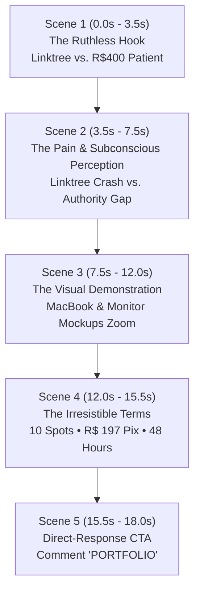

# EXECUTIVE CREATIVE & TECHNICAL BRIEF
## High-End Healthcare Landing Page Portfolio Campaign & 9:16 Reels Motion Graphic Specification

> [!IMPORTANT]
> **PURPOSE OF THIS DOCUMENT**  
> This specification is an end-to-end, self-contained brief engineered to be fed directly into an AI agent or motion design chat within Google Antigravity. It contains the exact commercial terms, visual assets, psychological hooks, and scene-by-scene motion design guidelines required to generate a high-converting 9:16 Instagram Reels motion graphic (1080×1920) designed to attract 2–3 passive inbound client leads for Grupo G2F AI.

---

## 1. Commercial Foundation & Campaign Architecture

### 1.1 The Core Proposition
Grupo G2F AI is selecting exactly **10 private healthcare professionals** (Clinical Psychologists, Clinical & Functional Nutritionists, Orthopedic Surgeons, and High-Ticket Doctors) to receive custom, magazine-grade digital flagships (Landing Pages) for their private practices.

* **Target Audience:** Established private doctors, psychologists, and nutritionists who currently rely on generic link aggregators (e.g., Linktree) or bare WhatsApp links in their Instagram bio, causing them to bleed high-paying private patients.
* **The Problem:** A private patient ready to pay R$ 350 to R$ 600+ for a consultation makes an instinctive trust decision within the first 4 seconds. An improvised Linktree signals amateurism, encourages price shopping, and forces the practitioner to compete with health insurance plans.
* **The Solution:** A bespoke, editorial-grade web property featuring medical-grade typography, trust architecture, structured clinical methodologies, and conversational WhatsApp triage buttons that deliver pre-educated, pre-qualified private patients.

### 1.2 Spots & Scarcity Mechanism
* **Strict Allocation:** Exactly **10 spots** available for this 2026 flagship portfolio cohort.
* **Fulfillment Window:** Turnaround guaranteed in **48 business hours** per client. Zero technical friction required from the practitioner.
* **Hard Stop:** The campaign closes immediately upon filling the 10th spot.

### 1.3 Terms & Pricing Structure
* **Anchored Regular Price:** R$ 790.00 (Standard clinical setup fee).
* **Exclusive Portfolio Fee:** **R$ 197.00 single payment via Pix** (instant bank settlement; no credit card processing delays, no 15-day escrow hold, no platform fees).
* **Mandatory Trade-off / Condition:** In exchange for the subsidized development fee (representing an ~75% discount off standard rates), the practitioner agrees to send a screenshot with an honest written testimonial once their page is live.
* **Turnkey Scope:** Grupo G2F AI writes the compliance-ready medical copy, builds the responsive layout, optimizes mobile rendering, and links direct appointment scheduling to the doctor's private WhatsApp (`+55 11 96223-6635`).

---

## 2. Visual Proof & Presentation Assets

The campaign is backed by three live, production-grade interactive clinical demos hosted on Vercel:

| Specialty | Doctor / Persona | Core Feature Highlights | Live Demo URL |
| :--- | :--- | :--- | :--- |
| **Clinical Psychology** | Dra. Camila Novaes | Welcoming editorial tones, clinical methodology, TCC & anxiety focus | [View Psychology Demo](https://grupo-g2-f-ai-sele-ao-de-portifolio.vercel.app/modelo-psicologa.html) |
| **Clinical Nutrition** | Dra. Mariana Costa | Luxury pearl/sage layout, InBody 770 bioimpedance, Gut-Brain axis | [View Nutrition Demo](https://grupo-g2-f-ai-sele-ao-de-portifolio.vercel.app/modelo-nutricionista.html) |
| **Orthopedics & Surgery** | Dr. Fernando Galha | Biomechanical dark-luxury aesthetic, 3D interactive pain map, symptom quiz | [View Orthopedics Demo](https://grupo-g2-f-ai-sele-ao-de-portifolio.vercel.app/ortopedia/index.html) |
| **Full Portfolio Showcase** | Multi-Specialty Stack | Standalone macOS computer mockup windows with quick jump pills | [View Sales Page](https://grupo-g2-f-ai-sele-ao-de-portifolio.vercel.app/) |

### High-Resolution Showcase Prints

#### Asset 01: Studio Monitor Showcase (Psychology Demo on Alienware Curved Display)
Below is the verified 9:16 vertical presentation of Dra. Camila Novaes' clinic flagship inside an executive dark-wood studio workspace:


#### Asset 02: Warm MacBook Pro Desk Presentation (Editorial Clinical View)
Below is the realistic 9:16 vertical presentation on a MacBook Pro over a natural oak desk with clinical notebook and coffee:


#### Asset 03: Editorial Architecture Reference
Clean typography, generous negative space, and warm clinical photography:


---

## 3. Motion Graphic Strategy for Instagram Reels (Passive Acquisition)

### 3.1 Marketing Objective
Generate **2 to 3 qualified inbound leads** per Reels video. Viewers must experience immediate cognitive friction ("My Linktree makes me look cheap"), witness the solution, perceive unquestionable aesthetic authority, and immediately message the keyword **"PORTFOLIO"** via Instagram Direct or WhatsApp.

### 3.2 Target Audience Mental State
* Doctors, psychologists, and nutritionists who spent 5–10 years in clinical training.
* They take immense pride in their physical office, decor, and consultation quality.
* They feel subconscious embarrassment that their bio link is a generic gray button list.
* They do not have time to learn WordPress, write copy, or deal with freelancers.

---

## 4. Scene-by-Scene Motion Storyboard (18 Seconds • 9:16 Aspect Ratio)

* **Format:** Vertical Video (`1080 × 1920 px`), 60 FPS or 30 FPS.
* **Duration:** 18.0 Seconds.
* **Audio Track:** Elegant, modern minimalist electronic beat with crisp mechanical clicks and smooth sub-bass risers (Lo-Fi Luxury / Deep Minimal).



---

### SCENE 1: The Ruthless Cognitive Hook (0.0s – 3.5s)
* **Visual Action:**
  * Clean, stark off-white background (`#FAFAF7`).
  * In the center, a realistic iPhone screen zooms in rapidly using an aggressive spring transition.
  * On the phone screen: an Instagram profile bio is tapped. A gray, generic Linktree pops up with mismatched fonts.
  * A bold kinetic typography overlay hits the screen with micro-motion blur:
* **Kinetic Text on Screen:**
  > **"The patient ready to pay R$ 400 for your consultation left in 4 seconds."**
* **Audio / SFX:**
  * 0.0s: Muffled phone tap sound.
  * 1.2s: Harsh digital error buzz / low-frequency drop.
  * 2.0s: Fast camera shutter click.

---

### SCENE 2: The Contrast & Perception Gap (3.5s – 7.5s)
* **Visual Action:**
  * Background shifts seamlessly into Deep Obsidian Green (`#161D19`).
  * Split-screen or swipe card reveal:
    * Left/Top Card (Red tint border): `Linktree / Bare WhatsApp` -> Text: *"Looks like amateur improvisation. Drives price haggling."*
    * Right/Bottom Card (Emerald glow border): `Dedicated Medical Flagship` -> Text: *"Justifies your private consultation fee in the first 5 seconds."*
  * Quick kinetic stat counter animating from `0%` to `82%`:
* **Kinetic Text on Screen:**
  > **"Your physical clinic is flawless. Why does your digital reception look improvised?"**
* **Audio / SFX:**
  * Smooth heavy metallic whoosh on the transition.
  * Rapid ticker audio for the percentage counter.

---

### SCENE 3: The Live Demo Showcase (7.5s – 12.0s)
* **Visual Action:**
  * Rapid camera pan into a high-end 3D mockup space featuring:
    1. The MacBook Pro mockup showing **Dra. Camila Novaes (Psychology Flagship)** with buttery smooth parallax page scrolling.
    2. Quick cut / camera sweep to the wide monitor displaying **Dra. Mariana Costa (Clinical Nutrition)** showcasing the InBody 770 bioimpedance widget and metabolic methodology.
  * Floating UI badges spring into view with slight rotational momentum:
    * Badge 1: `Turnkey in 48 Hours`
    * Badge 2: `100% Medical Ethics Compliant`
    * Badge 3: `Automatic WhatsApp Filtering`
* **Kinetic Text on Screen:**
  > **"Bespoke digital presence. Ready in 48 hours without you writing a single line."**
* **Audio / SFX:**
  * Gentle glass chime for each floating badge.
  * Smooth page glide sound (subtle tactile friction).

---

### SCENE 4: The 10-Spot Portfolio Offer (12.0s – 15.5s)
* **Visual Action:**
  * Luxury dark card with a shimmering Sage Gold border (`#5C7C65`).
  * Price anchor animation:
    * `Regular Price: R$ 790.00` appears, then gets struck through with a red spring line.
    * Giant glowing Pix price springs in: **`R$ 197`** (Single Pix Payment).
  * Badge stamp drops with impactful screen shake: `2026 OFFICIAL PORTFOLIO SELECTION • 10 SPOTS ONLY`.
  * Small floating legal pill: *"Condition: 1 honest feedback screenshot once live."*
* **Kinetic Text on Screen:**
  > **"10 Spots Only. R$ 197 on Pix. In exchange for your honest review."**
* **Audio / SFX:**
  * Heavy digital "thud" on the price drop.
  * Elegant coin/register ring on the R$ 197 reveal.

---

### SCENE 5: Direct-Response Final Call to Action (15.5s – 18.0s)
* **Visual Action:**
  * Background locks into high-contrast luxury dark gradient (`#161D19` to `#2E3E34`).
  * Clean, glowing primary button pulses rhythmically:
    * `COMMENT "PORTFOLIO"`
    * `OR DM US ON INSTAGRAM`
  * Sub-text with live countdown pulse: *"Spots close as soon as the quota is filled."*
  * Subtle Grupo G2F AI branding watermark at the bottom with verified badge.
* **Kinetic Text on Screen:**
  > **"Comment 'PORTFOLIO' below or DM us now to check availability."**
* **Audio / SFX:**
  * Uplifting melodic resolution chord.
  * Subtle WhatsApp message notification pop.

---

## 5. Technical Motion Design System (For Remotion / AE / Antigravity Agents)

When prompting or coding the motion graphic via Remotion, React, or After Effects, strictly adhere to these motion tokens:

### 5.1 Color Tokens
```css
--bg-deep: #161D19;         /* 60% of dark scenes */
--bg-card: #252F2A;         /* Surface layer */
--bg-light: #FAFAF7;        /* Clean clinical cream */
--accent-sage: #5C7C65;     /* G2F Primary brand green */
--accent-light: #7FA389;    /* Secondary highlight */
--text-white: #FFFFFF;
--text-muted: #A9B7AE;
--border-light: rgba(255, 255, 255, 0.08);
--gold-pill: #E2BA78;
```

### 5.2 Typography Tokens
* **Display / Serifs (Authority & Prestige):** `Playfair Display` or `Cormorant Garamond` (Weights: 600, 700).
* **Body / UI Labels (Clarity & Modernity):** `Plus Jakarta Sans` or `DM Sans` (Weights: 500, 700, 800).

### 5.3 Spring Physics Parameters (Remotion / Framer Motion Standards)
To prevent robotic or generic template motion, apply natural inertia:
* **Snappy Entrances (Text & Badges):** `damping: 14, mass: 0.6, stiffness: 180`
* **Card & Device Zoom Swings:** `damping: 20, mass: 1.0, stiffness: 120`
* **Price Strikethrough Line:** `damping: 12, mass: 0.4, stiffness: 220`

### 5.4 Audio & SFX Cue Sheet
| Timestamp | Trigger Event | SFX Recommendation |
| :--- | :--- | :--- |
| `0.00s` | iPhone Tap | `phone_screen_tap.wav` |
| `1.50s` | Text Hit | `heavy_impact_whoosh.wav` |
| `3.50s` | Background Switch | `deep_sub_bass_drop.wav` |
| `7.50s` | MacBook 3D Fly-in | `high_tech_camera_whoosh.wav` |
| `9.80s` | Badge Reveal | `minimal_bell_chime.wav` |
| `12.20s` | Strikethrough | `pen_strike_marker.wav` |
| `12.80s` | R$ 197 Drop | `heavy_impact_bass.wav` |
| `15.50s` | CTA Button Pulse | `clean_ui_pop.wav` |

---

## 6. How to Feed This into Another Antigravity Chat / Agent

To have an Antigravity subagent generate the complete Remotion code, React project, or motion graphics scripts, prompt it with the following directive:

```text
"Act as a World-Class Motion Designer and Remotion Creative Director. 
I have a complete creative brief for an Instagram Reels video (9:16 vertical, 1080x1920, 18 seconds) for Grupo G2F AI's Healthcare Landing Page Portfolio Campaign.
Read the full specification provided in REELS_MOTION_GRAPHIC_BRIEF_EN.md:
- Target: 10 portfolio spots at R$ 197 Pix.
- Visuals: Use the verified mockups of the Psychology and Nutrition landing pages.
- Structure: 5-scene narrative (Hook, Pain, Showcase, Offer, CTA).
- Physics: Implement custom spring curves and kinetic typography.
Now, generate the complete, production-ready Remotion Root and Composition code with assets linked and exact timings."
```

---

## 7. Conversion Protocol for Inbound Leads Generated by the Reels

When a professional comments **"PORTFOLIO"** or sends an Instagram Direct message:

* **Step 1 (Auto-Response / Immediate Reply within 5 mins):**
  > "Hello, Doctor! Thank you for reaching out. We have just 10 spots allocated for our 2026 official healthcare portfolio. Here is the live interactive demonstration we built for clinical practices: [Link to Nutrition or Psychology Demo]. Are you looking to upgrade your digital practice this week?"
* **Step 2 (Closing the R$ 197 Pix Spot):**
  > "Because this is an official case study selection, your setup is subsidized at our direct development cost of **R$ 197 via Pix** (standard rate is R$ 790). All we ask is an honest review screenshot once your page is delivered. Our Pix key is **11962236635** (WhatsApp Business). As soon as you confirm, your spot is locked and we launch your page within 48 hours."
